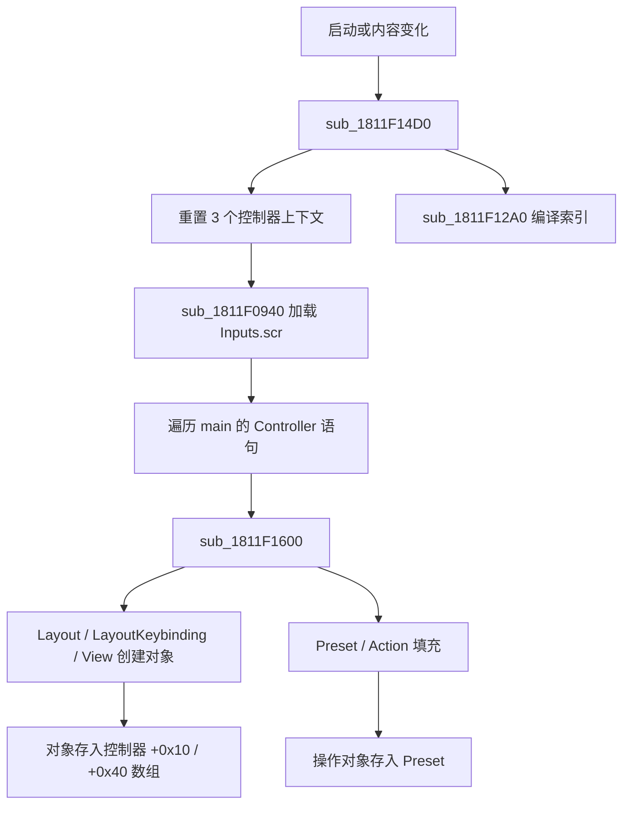

# 游戏快捷键（按键绑定）系统逆向记录

## 分析目标

目标是把游戏的按键绑定系统做成可复用的模组能力：

- 用函数注册一个快捷键（一个逻辑动作 + 默认按键）。
- 注册后，该快捷键出现在游戏“设置 → 控制 → 按键绑定”界面中（如截图中的“移动”页）。
- 支持注册一个新的按键绑定页面（View），例如在“移动”“动作”“物品”等页之外增加一页。

## 结论摘要

1. **整套快捷键系统是数据驱动的**。页面、行、动作分组、默认按键全部来自脚本：
   - `DW/Data/Scripts/Inputs/inputs.scr`（入口）
   - `DW/Data/Scripts/Inputs/inputs_keyboard.scr`（键盘）
   - `DW/Data/Scripts/Inputs/inputs_pad.scr`（手柄）
2. 脚本中的 `View(...)` 就是按键绑定界面的“页面”，`LayoutKeybinding(...)` 是可改键的“行”，`Layout(...) { Preset(...) { AddAction(...) } }` 是动作 → 按键的实际映射。
3. 原生侧 `GameInputsConverter`（gamedll 全局单例 VA `0x181D02B20`，RVA `0x1D02B20`）解析这些脚本，生成：
   - 控制器上下文（Keyboard / Pad / KeyboardAndPad）；
   - `InputsLayout`（布局/预设容器）、`InputsLayoutKeybinding`（可改键行）、`View`（页面）三类对象。
4. **新增快捷键/页面不需要改原生 UI 代码**：既可以在输入脚本里追加 `View` / `LayoutKeybinding` / `Layout`+`Preset`+`AddAction` 声明（数据方式），也可以在原生侧把这些对象直接注入 `GameInputsConverter`（ModSDK 已实现的 `EngineHotkeyRuntime` 使用后者）。
5. 原生侧在内容变化时会重新加载输入脚本（`sub_1811FAEC0` / `sub_181115FB0` 调用 `sub_1811F14D0`），因此运行时挂载包含新脚本的 pak 是可行的。
6. 坑位：`_ACTION_*` 不是无限枚举。`sub_1811F0CB0` 只注册 **0..337 共 338 个动作槽**（含未命名的空槽）。模组动作必须使用空槽或确认引擎能接受扩展槽位，不能随意使用 10000 这类值。

## 样本与工具

- 文件：`E:\SteamLibrary\steamapps\common\Dying Light\gamedll_x64_rwdi.dll`
- 大小：31,792,192 字节
- MD5：`97046bba5eb07a918acff82a394e8c8b`
- SHA-256：`76f20d27c45c0b807d2f099022ad0abc42ca90a8ade7f761641518af346d26a0`
- IDA：preferred image base `0x180000000`
- 数据：`DW/Data0.pak`（标准 ZIP，可直接用 .NET `ZipFile`/7-Zip 解包）

下文地址均为该 DLL 的静态 VA。运行时使用 `RVA = VA - 0x180000000`，再加模块实际基址。

---

## 一、脚本层：快捷键系统的“源数据”

### 1.1 入口 `inputs.scr`

`DW/Data/Scripts/Inputs/inputs.scr` 只有 480 字节：

```scr
//AddAction(_ACTION_ID, EInputTarget, EInputDevice, analog, AxisOrButtonId, reverse, halfscope)

import "inputs.def" 
import "inputs_pad.scr"
import "inputs_keyboard.scr"
import "inputs_gesture.scr"

sub main()
{
    Controller("Keyboard")
    {
        use Keyboard();
    }
    Controller("Pad")
    {
        use Pad();
        use Gestures();
    }
    Controller("KeyboardAndPad")
    {
        use Pad();  
        use Keyboard();
        use Gestures();
    }
}
```

- `Controller("Keyboard" | "Pad" | "KeyboardAndPad")` 对应转换器内部的三个控制器上下文，偏移分别是 `+0`、`+64`、`+128`。
- `use Keyboard();` 把 `inputs_keyboard.scr` 中 `sub Keyboard()` 的函数体在当前控制器上下文里执行一遍。
- 解析器 `sub_1811F0940` 只做三件事：加载 `Inputs.scr` → 找 `main` → 遍历 `main` 的 `Controller` 语句，把语句体和控制器偏移交给 `sub_1811F1600`。

### 1.2 键盘脚本结构 `inputs_keyboard.scr`

```scr
sub Keyboard()
{
    // ① 动作→按键的实际映射（默认预设）
    Layout("common_keyboard", false)
    {
        Preset("")
        {
            AddAction(_ACTION_FORWARD, EInputTarget_Player, EInputDevice_Keyboard, false, EKey__W, false, false);
            ...
        }
    }

    // ② 带选项的布局（下蹲切换/冲刺切换/瞄准切换/反转Y）
    Layout("Keybinding_DuckMode")
    {
        Preset("&OptionOn&")
        {
            RemoveAction(_ACTION_DUCK, EInputDevice_Keyboard);
            AddAction(_ACTION_DUCK_TOGGLE, EInputTarget_Player, EInputDevice_Keyboard, false, EKey__C, false, false);
        }
        Preset("&OptionOff&") { ... }
    }

    // ③ 可改键的“行”：把若干逻辑动作归到同一行
    LayoutKeybinding("Keybinding_MoveForward", _CATEGORY_BASE, _COLLIDE_BASE)
    {
        Action(_ACTION_FORWARD);
        Action(_ACTION_CLIMB_UP);
        Action(_ACTION_GRAPPLE_POINT_UP);
        Action(_ACTION_QTE4);
    }

    // ④ 按键绑定页：View = 页面，内部 Layout = 页面中的行
    View("&Keybinding_View_Movement&")
    {
        Layout("Keybinding_MoveForward", "&Keybinding_MoveForward&");
        Layout("Keybinding_MoveBackward", "&Keybinding_MoveBackward&");
        ...
    }
}
```

### 1.3 语义对照表

| 声明 | 作用 | 备注 |
|------|------|------|
| `Controller(name)` | 选择控制器上下文 | `Keyboard`=+0，`Pad`=+64，`KeyboardAndPad`=+128 |
| `use fn()` | 在当前上下文执行脚本函数 | 用于复用 `sub Keyboard()` / `sub Pad()` |
| `Layout(name[, visible])` | 定义/复用“布局”（预设容器） | `visible=false` 的布局不出现在绑定页（如 `common_keyboard`） |
| `Preset(label)` | 定义/复用布局下的预设 | 带选项的行会有 `&OptionOn&` / `&OptionOff&` 两个预设 |
| `AddAction(...)` | 预设中的动作→设备/按键映射 | 编译为 44 字节绑定记录 |
| `RemoveAction(action, device)` | 从预设中删除映射 | 常用于选项切换 |
| `SwapActions(a, b)` / `SwapInputs(dev, a, b)` | 交换动作/输入 | 反转Y、手柄布局用 |
| `LayoutKeybinding(name, cat, collide[, flag])` | 定义可改键行 | `Action(id)` 把动作加入该行 |
| `Action(id)`（在 LayoutKeybinding 内） | 把动作 ID 加入行的动作集合 | 行内动作共用同一个按键 |
| `View(title[, dlc])` | 定义按键绑定页面 | 支持 DLC 过滤（`"DLC1"`、`"DLC17"`） |
| `Layout(name, label)`（在 View 内） | 页面中的一行 | `label` 是显示文本（本地化 token 或纯文本） |
| `Action(id, label)`（在 View 内） | 手柄页面中的“纯展示”行 | 键盘页面不用 |

### 1.4 默认的页面（View）清单

键盘（`inputs_keyboard.scr`）：

| 页面标题 key | 脚本行号 | 含义（中文本地化） |
|--------------|----------|--------------------|
| `&Keybinding_View_Movement&` | 725 | 移动 |
| `&Keybinding_View_Actions&` | 738 | 动作 |
| `&Keybinding_View_Inventory&` | 753 | 物品 |
| `&Keybinding_View_QuickSelect&` | 767 | 快速选择 |
| `&Keybinding_View_Other&` | 779 | 其他 |
| `&Keybinding_View_Coop&` | 792 | 合作 |
| `&Keybinding_View_Hunter&`（DLC1） | 803 | 猎手 |
| `&Keybinding_View_Buggy&`（DLC17） | 821 | 越野车 |

手柄（`inputs_pad.scr`）：

| 页面标题 key | 脚本行号 | 备注 |
|--------------|----------|------|
| `&MenuGamepad_View_Game&` | 475 | 常规 |
| `&MenuGamepad_View_Hunter&`（DLC1） | 508 | 猎手 |
| `&MenuGamepad_View_Buggy&`（DLC17） | 536 | 越野车 |

截图中的“移动”页就是 `&Keybinding_View_Movement&`；页内的行来自该 `View` 块中的 `Layout(...)` 列表。

### 1.5 动作 ID 空间

- 动作 ID 由 C++ 枚举注册到脚本 VM。`sub_1811F0CB0` 会遍历 **0..337**（`v21 < 338`），从描述符表 `qword_181CDE7D0` 中查找对应名称，找不到则注册为 `<Unknown value>`。
- 描述符是 24 字节：`+0` 名称指针、`+8/+12` 长度/容量、`+16` 动作值。
- 已知最大具名动作：`_ACTION_PUSH_TO_TALK = 337`。
- **结论**：0..337 是已有的 338 个槽位，其中存在未命名的空槽。模组动作应优先占一个空槽；不要直接使用 338+ 或 10000+，否则可能落到引擎动作数组之外。

> 运行时可复刻 `sub_1811F0CB0` 的查找逻辑：扫描 `qword_181CDE7D0`（最多 0x111 项），收集所有出现过的 `+16` 值，然后在 0..337 中选一个未出现的值作为模组动作 ID。

### 1.6 分类标志

`inputs_keyboard.scr` 顶部导出：

```scr
export int _CATEGORY_BASE   = 1;  // 人类/僵尸通用
export int _CATEGORY_HUMAN  = 2;  // 仅人类
export int _CATEGORY_ZOMBIE = 4;  // 仅猎手
export int _CATEGORY_BUGGY  = 8;  // 仅越野车
export int _COLLIDE_* = 组合
```

`LayoutKeybinding` 的第 2/3 个参数就是这些标志，决定该行在不同模式下的显示/冲突判定。

脚本枚举的原生取值（由 `sub_18115A590` / `sub_18115A4B0` 生成）：

| `EInputDevice_*` | 值 | | `EInputTarget_*` | 值 |
|------------------|----|---|------------------|----|
| `EInputDevice_Mouse` | 0 | | `EInputTarget_HUD` | 0 |
| `EInputDevice_Keyboard` | 1 | | `EInputTarget_Player` | 1 |
| `EInputDevice_Analog` | 2 | | `EInputTarget_Module` | 2 |
| `EInputDevice_Gesture` | 3 | | | |
| `EInputDevice_Kinect` | 4 | | | |

---

## 二、原生对象模型

所有对象由 `GameInputsConverter` 解析脚本时创建，存放在全局单例 `unk_181D02B20`（VA `0x181D02B20`，RVA `0x1D02B20`）中。

### 2.1 单例与控制器上下文

```
GameInputsConverter（单例 +0x0 起，大小 ≥ 0x1B8）
├─ +0x000  Controller "Keyboard"        （64 字节）
├─ +0x040  Controller "Pad"             （64 字节）
├─ +0x080  Controller "KeyboardAndPad"  （64 字节）
└─ +0x0C0  当前选择/编译状态（92 字节结构）
```

每个控制器上下文（64 字节）：

| 偏移 | 类型 | 含义 |
|------|------|------|
| `+0x00` | ttl::string (16B) | 控制器名（"Keyboard" 等） |
| `+0x10` | void** | 条目数组：`InputsLayout` / `InputsLayoutKeybinding` 指针 |
| `+0x18` | int | 条目数量 |
| `+0x1C` | int | 条目容量 |
| `+0x20` | int | 未完全确认 |
| `+0x28` | void* | **View（页面）数组**，64 字节/项 |
| `+0x30` | int | View 数量 |
| `+0x34` | int | View 容量 |
| `+0x38` | int | 未完全确认 |

`+0xC0` 选择状态（部分字段已确认）：

| 偏移 | 含义 |
|------|------|
| `+0xC0` | 当前控制器索引（-1 表示无），菜单/辅助函数会临时改写 |
| `+0xC8 + 24*i` | 第 i 个控制器的“每条目值数组”：布局条目存当前预设索引，可改键行存按键覆盖值（0 = 无覆盖） |
| `+0x110 + 4*i` | 第 i 个控制器当前选中的 **View 索引**（`sub_1811F3C60` 写入） |

> `sub_1811566F0` 的 92 字节拷贝与 `sub_181152AE0` 的初始化可作为该结构的交叉验证。

### 2.2 `InputsLayout`（布局/预设容器，0x38 字节）

| 偏移 | 含义 |
|------|------|
| `+0x00` | vftable（`??_7InputsLayout@@6B@`，VA `0x181891BD8`） |
| `+0x08` | 名称（"common_keyboard"、"Keybinding_DuckMode" 等） |
| `+0x18` | 预设数组指针 |
| `+0x20` | 预设数量 |
| `+0x24` | 预设容量 |
| `+0x28` | 常量 59（类型标记） |
| `+0x30` | 字节 1 |

虚表方法（VA）：

| 槽 | 函数 | 作用 |
|----|------|------|
| 0 | `0x1811F2710` | 析构 |
| 1 | `0x1811F1FC0` | 处理 `Preset(...)` 语句：按名字复用/新建预设，再执行预设体 |
| 2 | `0x1811F2520` | **把某个预设编译进 44 字节绑定记录数组**（`sub_1811F2520(layout, records, presetIndex)`） |
| 3 | `0x1811F25D0` | 在该布局的预设里按记录做匹配 |
| 4 | `0x1811F2660` | 按分类标志筛选并返回索引 |

### 2.3 `Preset`（预设，0x38 字节）

| 偏移 | 含义 |
|------|------|
| `+0x00` | 名称（`""`、`&OptionOn&`、`&OptionOff&`） |
| `+0x10` | 操作对象数组（`IInputsActionListOperation*`） |
| `+0x18` | 操作数量 |
| `+0x1C` | 操作容量 |
| `+0x20` | 常量 59 |
| `+0x28` | `-1` |
| `+0x30` | 字节 0 |
| `+0x34` | `-1` |

操作对象在 `sub_1811EF1F0` 中创建（`AddAction` / `RemoveAction` / `SwapActions` / `SwapInputs` / `AddGesture`），每个 0x38 字节：

- vtable[0]：把自身转换成 44 字节记录并追加到记录数组；
- vtable[1]：判断某条 44 字节记录是否归属自己（用于删除/改键匹配）。

### 2.4 `InputsLayoutKeybinding`（可改键行，0x60 字节）

| 偏移 | 含义 |
|------|------|
| `+0x00` | vftable（VA `0x181891C20`） |
| `+0x08` | 名称（如 "Keybinding_MoveForward"） |
| `+0x38` | `_CATEGORY_*` 分类 |
| `+0x3C` | `_COLLIDE_*` 分类 |
| `+0x40` | 字节 1（第 4 个布尔参数相关） |
| `+0x48` | 动作 ID 红黑树根（`Action(id)` 插入这里） |
| `+0x50` | 0 |
| `+0x58` | 常量 59 |

虚表方法：

| 槽 | 函数 | 作用 |
|----|------|------|
| 0 | `0x1811F2FE0` | 析构（释放 +0x48 的动作树） |
| 1 | `0x1811F3140` | 处理 `Action(id)`：把动作 ID 插入红黑树，同时写入名称/分类 |
| 2 | `0x1811F3080` | **改键写回**：对记录数组中匹配该行的记录写入新按键 |
| 3 | `0x1811F36C0` | 判断某条记录的动作 ID 是否属于该行（红黑树查找） |

`sub_1811F3080` 的写回细节（`records` 为 `{ptr,count,cap}`）：

```
record + 0x08 = (key & 0xF00) == 0 ? 1 : 0     // 键盘/非键盘分类
record + 0x10 = key & 0xFFFFF0FF               // 按键编码（EKey/EJoy/EMouse）
```

### 2.5 `View`（按键绑定页面，64 字节）

| 偏移 | 含义 |
|------|------|
| `+0x00` | 页面标题（如 `&Keybinding_View_Movement&`） |
| `+0x10` | 行数组指针（24 字节/项） |
| `+0x18` | 行数量 |
| `+0x1C` | 行容量 |
| `+0x20` | 常量 59 |
| `+0x28` | 直接动作数组指针（手柄页面用） |
| `+0x30` | 数量 |
| `+0x34` | 容量 |
| `+0x38` | 常量 59 |

行记录（24 字节）：

```
+0x00  InputsLayout* / InputsLayoutKeybinding*   // 该行对应的布局对象
+0x08  ttl::string 显示文本                      // 如 "&Keybinding_MoveForward&"
```

直接动作记录（24 字节）：

```
+0x00  int actionId
+0x08  ttl::string 显示文本
```

### 2.6 44 字节绑定记录

由 `AddAction` 操作编译得到（`0x2C` 字节/条）：

| 偏移 | 含义 |
|------|------|
| `+0x00` | int 动作 ID |
| `+0x04` | int target（`EInputTarget_*`） |
| `+0x08` | int 设备分类/模拟量标志 |
| `+0x0C` | int analog |
| `+0x10` | int 按键编码（`EKey__*` / `EJoy__*` / `EMouse__*`） |
| `+0x14` | int reverse |
| `+0x18` | int halfScope |
| `+0x1C` | Hysteresis |
| `+0x20` | HoldTime / DubbleClick 参数（8 字节） |
| `+0x28` | 附加标志 |

`sub_1811F3080` 改键只改 `+0x08` 和 `+0x10`；其余字段由 `AddAction` 决定。

---

## 三、关键函数表

| VA | RVA | 名称/作用 |
|----|-----|-----------|
| `0x181D02B20` | `0x1D02B20` | `GameInputsConverter` 全局单例 |
| `0x1811F0880` | `0x11F0880` | 单例构造：初始化 3 个控制器上下文并解析 `Inputs.scr` |
| `0x1811F14D0` | `0x11F14D0` | **重载输入脚本**：重置控件上下文 → `sub_1811F0940` → 编译 |
| `0x1811F0940` | `0x11F0940` | 加载 `Inputs.scr`、找 `main`、遍历 `Controller` 语句 |
| `0x1811F0CB0` | `0x11F0CB0` | 注册脚本常量：`EInputDevice_*`、`EInputTarget_*`、`EKinect_*`、0..337 动作名 |
| `0x1811F1600` | `0x11F1600` | 处理 `Layout` / `LayoutKeybinding` / `View` 语句 |
| `0x1811F1D80` | `0x11F1D80` | 在控制器条目数组中按名称查找对象 |
| `0x1811F1E50` | `0x11F1E50` | 同上，返回索引 |
| `0x1811F1FC0` | `0x11F1FC0` | `InputsLayout` 虚表[1]：处理 `Preset` |
| `0x1811EF010` | `0x11EF010` | 执行预设体 |
| `0x1811EF1F0` | `0x11EF1F0` | `AddAction`/`RemoveAction`/`SwapActions`/`SwapInputs`/`AddGesture` 解析 |
| `0x1811F2830` | `0x11F2830` | 填充 `View`：处理 `Layout(name,label)` 与 `Action(id,label)` |
| `0x1811F3140` | `0x11F3140` | 填充 `InputsLayoutKeybinding`：处理 `Action(id)` |
| `0x1811F3080` | `0x11F3080` | 改键写回记录数组 |
| `0x1811F36C0` | `0x11F36C0` | 行 → 动作匹配（红黑树） |
| `0x1811F2520` | `0x11F2520` | 布局预设 → 44 字节记录数组 |
| `0x1811F2660` | `0x11F2660` | 按分类筛选布局 |
| `0x1811F3700` | `0x11F3700` | UI：为“带选项的行”生成预设下拉列表 |
| `0x1811F37F0` | `0x11F37F0` | UI：读取/恢复当前选中预设 |
| `0x1811F3AC0` | `0x11F3AC0` | UI：读取当前选中索引 |
| `0x1811F3C60` | `0x11F3C60` | **按名字选择 View（页面）索引**（猎手模式切页用） |
| `0x1811F3E10` | `0x11F3E10` | 释放 View 数组 |
| `0x1811F3EF0` | `0x11F3EF0` | 初始化 View 数组 |
| `0x1811FAEC0` | `0x11FAEC0` | 内容变化：清脚本缓存 → **重载输入** |
| `0x181115FB0` | `0x1115FB0` | 同上（另一入口） |
| `0x180494140` | `0x494140` | 猎手模式切换：按名字选择 `&Keybinding_View_Hunter&` / `&MenuGamepad_View_Hunter&` |
| `0x18006F840` | `0x6F840` | 构建动作描述符表（名称 + 动作值） |
| `0x180918B50` | `0x918B50` | 按键绑定 UI：构建 44 字节记录数组 |
| `0x180919180` | `0x919180` | 按键绑定 UI：生成行（`UIOptionKeySelect`，模板 `"KeySelectDummy"`）并显示当前按键 |
| `0x180919870` | `0x919870` | 按键绑定 UI：冲突/缺失检测 |
| `0x180919DF0` | `0x919DF0` | 收集当前控制器所有 View 的 `InputsLayoutKeybinding` |
| `0x180917D60` | `0x917D60` | 设置菜单 UI 初始化（查找 `KeyList` 等控件） |

---

## 四、运行时流程

### 4.1 加载/重载



- 内容变化（挂载 pak、模组加载等）会走 `OnContentChanged`，随后**重新执行整条输入脚本解析链**。这意味着运行时挂载包含新脚本的 pak 可以生效。

### 4.2 打开按键绑定页

1. 菜单对象在 `+1104` 保存 `GameInputsConverter*`。
2. 读取 `converter + 0xC0` 得到当前控制器索引。
3. 页面列表 = `converter + controller*64 + 0x28` 的 64 字节 `View` 数组；页面标题在 `View+0`。
4. 选中页面时，索引写入 `converter + 0x110 + 4*controller`（`sub_1811F3C60`）。
5. 行列表 = `View + 0x10` 的 24 字节记录数组；每项 `{布局对象, 显示文本}`。
6. 菜单遍历控制器 `+0x10` 数组中的 `InputsLayout`，调用虚表[2]（`sub_1811F2520`）把当前预设编译成 44 字节记录数组。
7. 对每个 `InputsLayoutKeybinding` 行，用虚表[3]（`sub_1811F36C0`）在记录数组里找到对应按键，显示在 `UIOptionKeySelect` 中。

### 4.3 改键

1. UI 捕获新按键，编码为 `EKey__*` / `EJoy__*` / `EMouse__*`（特殊值 `0xFFFF` 表示清空）。
2. 通过名字在控制器 2（KeyboardAndPad）和 0（Keyboard）的条目数组里找到目标 `InputsLayoutKeybinding`，把新按键写入 `converter + 0xC8 + 24*controller` 的**每条目值数组**（`sub_180919CC0`）。
3. 之后构建 44 字节记录数组时，对每个条目调用虚表[2]：
   - `InputsLayout` → 应用当前预设索引；
   - `InputsLayoutKeybinding` → 若每条目值非 0，则把该值作为新按键覆盖到匹配的动作记录（`sub_1811F3080`）。
4. 因此改键在运行时立即生效；磁盘持久化的具体文件路径尚未定位，但保存/加载走的是同一套条目名 + 值映射。

---

## 五、实现方案

### 方案 A：脚本/数据注入（备选，适合纯数据模组）

不改原生解析逻辑，只让游戏解析到模组声明。

#### A.1 覆盖 `inputs.scr`

在模组 pak 中提供 `data/scripts/inputs/inputs.scr`，内容为原版 + 一个 import + 三个 `use`：

```scr
import "inputs.def" 
import "inputs_pad.scr"
import "inputs_keyboard.scr"
import "inputs_gesture.scr"
import "mod_inputs.scr"

sub main()
{
    Controller("Keyboard")
    {
        use Keyboard();
        use ModKeyboard();
    }
    Controller("Pad")
    {
        use Pad();
        use Gestures();
        use ModPad();
    }
    Controller("KeyboardAndPad")
    {
        use Pad();  
        use Keyboard();
        use Gestures();
        use ModKeyboard();
        use ModPad();
    }
}
```

#### A.2 生成 `mod_inputs.scr`

```scr
import "inputs.def"

// MOD_ACTION_ID_1 / MOD_ACTION_ID_2 必须是 0..337 中的空闲动作槽。
// 生成器在运行时应先扫描描述符表（见 1.5 节）挑选空槽，再替换成数字。
sub ModKeyboard()
{
    // 1) 把默认按键加进已有的 "common_keyboard" 布局
    //    Layout/Preset 会按名字复用已有对象，不会清空原版绑定
    Layout("common_keyboard")
    {
        Preset("")
        {
            AddAction(MOD_ACTION_ID_1, EInputTarget_Module, EInputDevice_Keyboard, false, EKey__F7, false, false);
            AddAction(MOD_ACTION_ID_2, EInputTarget_Module, EInputDevice_Keyboard, false, EKey__F8, false, false);
        }
    }

    // 2) 每个快捷键一行
    LayoutKeybinding("Keybinding_Mod_Test1", _CATEGORY_BASE, _COLLIDE_BASE)
    {
        Action(MOD_ACTION_ID_1);
    }
    LayoutKeybinding("Keybinding_Mod_Test2", _CATEGORY_BASE, _COLLIDE_BASE)
    {
        Action(MOD_ACTION_ID_2);
    }

    // 3) 新页面：View 会追加一个新页（不会合并进原版“移动”页）
    View("&Keybinding_View_Mods&")
    {
        Layout("Keybinding_Mod_Test1", "模组功能 1");
        Layout("Keybinding_Mod_Test2", "模组功能 2");
    }
}

sub ModPad()
{
    // 需要手柄支持时按同样方式写，设备改为 EInputDevice_Analog，
    // 按键改为 EJoy__BUTTON_* 等。
}
```

说明：

- `MOD_ACTION_ID_*` 必须是**空闲动作槽**。按第 1.5 节在 0..337 内选空槽；如果只是想验证 UI，可先用一个已知存在但未绑定的动作值做临时测试。
- `_CATEGORY_BASE` / `_COLLIDE_BASE` 由 `inputs_keyboard.scr` 导出，`inputs.scr` 已先 import，可直接使用。
- 行标签和页面标题写纯文本通常能直接显示；若游戏文本系统要求 `&token&`，可复用已有 token，或通过 `data/texts_temp.scr` 的 `String("key", "文本")` 机制补充（该文件在 gamedll 中有 `texts_temp` 字符串引用，但是否在所有版本加载需实测）。
- **页面的“移动”页无法通过追加 View 直接加行**：`View` 解析分支总是新建页面，不会按名字合并。若必须把模组行放进原版“移动”页，需要覆盖完整的 `inputs_keyboard.scr`（在 `View("&Keybinding_View_Movement&")` 块中插入 `Layout(...)` 行），成本较高；一般建议模组自建页面。

#### A.3 挂载

- 引擎侧已有文件系统挂载能力（`CustomPakMod` 使用 `filesystem_x64_rwdi.dll` 的 `AddSource`）。
- 生成一个 pak（ZIP），包含：
  - `data/scripts/inputs/inputs.scr`
  - `data/scripts/inputs/mod_inputs.scr`
- 在模组加载阶段挂载；游戏的 `OnContentChanged → sub_1811F14D0` 会重新解析输入脚本，新页面/新行随之出现。

#### A.4 检测快捷键

两种可选实现：

1. **读取游戏记录 + 轮询按键（推荐，改键自动生效）**
   - 游戏的原生记录数组是临时构建的，但构建规则固定：对每个条目调虚表[2]，传入每条目值数组（布局=当前预设索引，可改键行=按键覆盖值）。
   - 模组可在需要时自行调用同样的函数，得到 44 字节记录数组，找到自己的动作 ID → 当前按键编码。
   - 键盘按键编码就是 DirectInput 扫描码（`EKey__W = 0x11` 等），可用 DirectInput 键盘状态/`GetAsyncKeyState` 映射轮询。
   - 改键后无需额外处理，下次读取记录即可拿到新键。

2. **挂钩改键写回**
   - Hook `sub_1811F3080`，在游戏写入新按键时同步缓存（注意该函数被所有行共用，需要按动作 ID 过滤）。

### 方案 B：原生对象注入（已实现）

ModSDK 的 `EngineHotkeyRuntime` 采用这条路径，不依赖修改 `inputs.scr`：

1. Hook `sub_1811F14D0`（输入脚本重载）。每次原版解析完成后：
   - 向 `common_keyboard` 布局的默认预设追加 `InputsActionListOperation_AddAction` 操作（0x38 字节）；
   - 向 `converter + controller*64 + 0x10` 条目数组追加 `InputsLayoutKeybinding`（0x60 字节）；
   - 向 `converter + controller*64 + 0x28` 页面数组追加 `View`（64 字节），行记录 24 字节；
   - 调用 `sub_1811F12A0` 重建每条目值数组，再 `sub_1811566F0` 拷回 `converter + 0xC0`。
2. 只处理控制器 0（Keyboard）与 2（KeyboardAndPad）。
3. 动作 ID 自动从描述符表 `qword_181CDE7D0` 的空槽中分配。
4. 轮询时对控制器 0 的每个条目调用虚表[2] 构建 44 字节记录数组；可改键行会应用每条目值数组中的按键覆盖。
5. 对象内存使用 `ucrtbase.dll` 的 `malloc/realloc/free`，避免 Debug/Release CRT 堆不匹配。

> 该路径对 `gamedll_x64_rwdi.dll` 版本敏感；运行时通过 `SizeOfImage == 0x1F64000` 做构建校验，不匹配时自动禁用热键注入。

---

## 六、已验证 / 待验证

### 已验证（静态反编译）

- `inputs.scr` → `Controller` → `Keyboard()`/`Pad()` 的解析链。
- `Layout` / `Preset` / `AddAction` / `LayoutKeybinding` / `Action` / `View` 的对象创建与字段布局。
- 页面（View）数组、行（LayoutKeybinding）数组、预设操作列表、44 字节记录格式。
- 338 个动作槽（0..337）的注册逻辑。
- 内容变化会重载输入脚本。
- 按键绑定 UI 使用 `View` + `InputsLayoutKeybinding` + 44 字节记录显示当前按键。

### 待验证（需要进游戏实测）

- 空闲动作槽的实际可用性（引擎是否对空槽有额外限制）。
- 纯文本页面标题/行标签是否直接显示（还是必须本地化 token）。
- 运行时挂载 pak 后 `OnContentChanged` 重载的时序，是否一定在 UI 打开前完成。
- 改键结果在运行时的生效链路已确认（每条目值数组 + 虚表[2] 覆盖）；磁盘持久化的具体文件路径/键名未定位。
- 游戏内 UI 对普通字符串（非 `&token&`）标题的处理需实测。
- 手柄按键的轮询尚未实现（v1 只支持键盘与鼠标侧键）。

### 实现状态

`EngineHotkeyRuntime` 已实现并通过 x64 Release 全量编译；构建产物：

```text
build/x64/RELEASE/DyingLightModEngine.dll
build/Mods/ExampleMod/x64/RELEASE/example_mod.dll
```

由于本轮未部署到游戏目录，以下内容仍需进游戏实测：

- 输入重载 hook 是否按预期触发并完成注入。
- 新页面与新行是否出现在“设置 → 控制 → 按键绑定”。
- 改键后轮询是否读到覆盖值。
- 页面标题/行标签的纯文本显示效果。

---

## 七、ModSDK 已实现的接口

实现文件：

- `DyingLightModEngine/include/sdk/EngineHotkeyAbi.h`
- `DyingLightModEngine/include/runtime/EngineHotkeyRuntime.h`
- `DyingLightModEngine/src/runtime/EngineHotkeyRuntime.cpp`

Host API 新增字段 `DlModHostApiV1::hotkey`（末尾追加，保持旧 ABI 兼容）：

```c
typedef void(MODSDK_CALL* DlModHotkeyCallbackV1)(
    void* userData,
    uint32_t actionId);

typedef struct DlModHotkeyDescV1 {
    uint32_t structSize;
    uint32_t abiVersion;
    const char* id;             // 模组内唯一，如 "mymod.foo"
    const char* displayName;    // 按键绑定行显示文本
    const char* pageTitle;      // 页面标题；为空表示默认页 "Mods"
    uint32_t defaultKey;        // EKey__* / 鼠标 0xF000+
    uint32_t device;            // 保留，DLMOD_HOTKEY_DEVICE_INFER
    uint32_t target;            // 保留，写 0
    void* userData;
    DlModHotkeyCallbackV1 callback;
} DlModHotkeyDescV1;

typedef struct DlModHotkeyApiV1 {
    uint32_t structSize;
    uint32_t abiVersion;
    DlModResult (MODSDK_CALL* registerHotkey)(const DlModHotkeyDescV1* desc);
    uint32_t (MODSDK_CALL* getHotkeyKey)(const char* id);    // 当前绑定键
    uint32_t (MODSDK_CALL* getHotkeyAction)(const char* id); // 分配到的动作 ID
    DlModResult (MODSDK_CALL* unregisterHotkey)(const char* id); // OnUnload 必须调用
} DlModHotkeyApiV1;
```

使用示例（`Mods/ExampleMod` 已接入）：

```cpp
DlModHotkeyDescV1 hotkey{};
hotkey.structSize = sizeof(hotkey);
hotkey.abiVersion = DLMOD_HOTKEY_ABI_VERSION;
hotkey.id = "example.mod.toggle_uv_shield";
hotkey.displayName = "Toggle UV Shield";
hotkey.pageTitle = "Example Mod";
hotkey.defaultKey = DLMOD_HOTKEY_KEY_F7;
hotkey.device = DLMOD_HOTKEY_DEVICE_INFER;
hotkey.userData = &state;
hotkey.callback = &OnShieldHotkey;

if (hostApi->structSize >= DLMOD_HOST_API_V1_HOTKEY_SIZE &&
    hostApi->hotkey != nullptr &&
    hostApi->hotkey->structSize >= DLMOD_HOTKEY_API_V1_SIZE &&
    hostApi->hotkey->abiVersion == DLMOD_HOTKEY_ABI_VERSION) {
    hostApi->hotkey->registerHotkey(&hotkey);
}
```

运行时行为：

1. 在模组 `OnLoad` 中收集注册；页面按 `pageTitle` 分组，一个页面一个 `View`。
2. Hook `sub_1811F14D0`（输入脚本重载）；每次重载后把模组条目注入：
   - 向 `common_keyboard` 的默认预设追加 `AddAction` 操作；
   - 向 Keyboard / KeyboardAndPad 两个控制器追加 `InputsLayoutKeybinding` 行；
   - 向两个控制器追加 `View` 页面；
   - 调用 `sub_1811F12A0` + `sub_1811566F0` 重建每条目值数组。
3. 动作 ID 从 `qword_181CDE7D0` 描述符表扫描出 0..337 中的空闲槽，自动分配。
4. 轮询：每 250ms 通过布局虚表[2] 构建 44 字节记录数组，读取热键动作的当前按键（包含 UI 改键覆盖），用 `GetAsyncKeyState` 检测按下沿并回调。
5. 改键沿用游戏 UI：`sub_180919CC0` 把新按键写入每条目值数组，随后记录构建时由 `sub_1811F3080` 覆盖到动作记录，本运行时下一轮轮询即可读到新键。

限制：

- 手柄/摇杆按键暂不轮询（按键编码 >= 0xF00 且 < 0xF000 会被忽略）。
- 行/页面标题建议使用 ASCII 或 UTF-8 纯文本；若游戏文本系统要求 `&token&`，需要额外补充本地化。
- 热键对象生命周期与进程一致；模组卸载或 OnLoad 失败时，引擎会按 owner 自动清理，但仍建议在 OnUnload 显式调用 `unregisterHotkey`。
